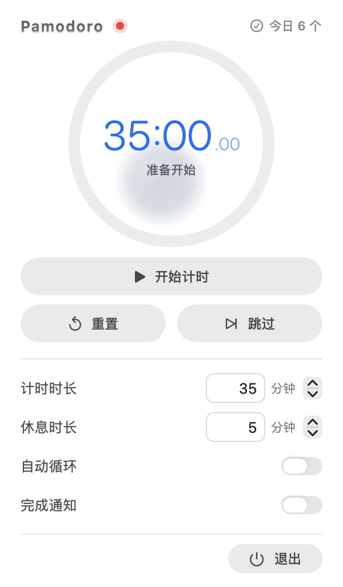
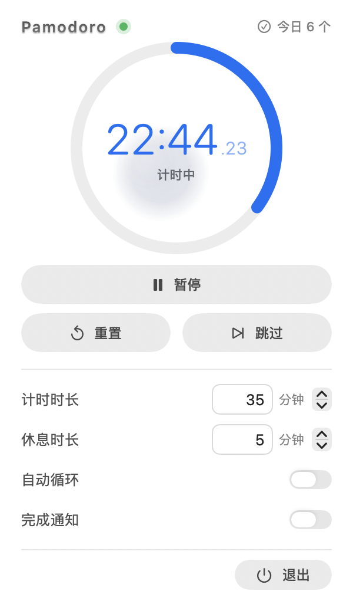
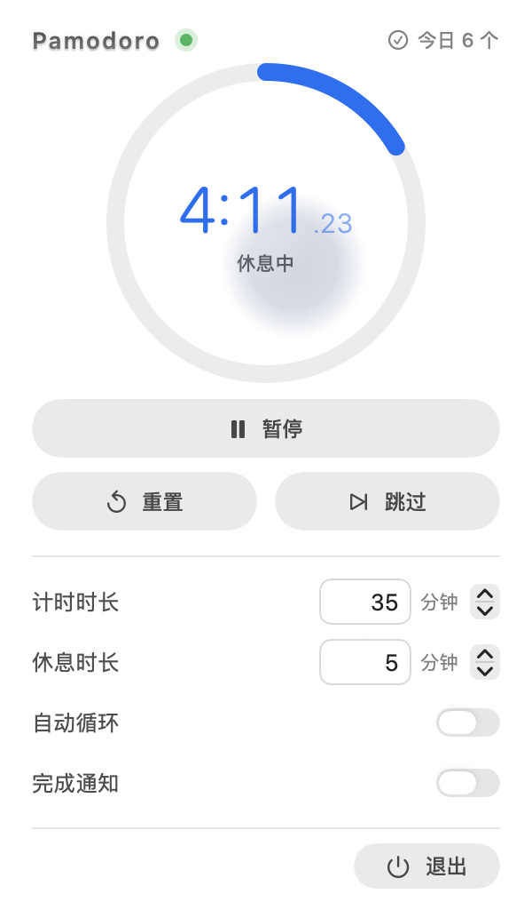
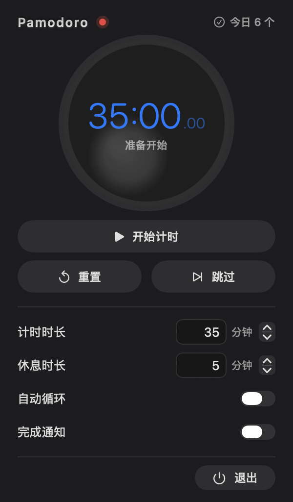

# ⌛️ 番茄钟 · macOS 菜单栏计时器

> 一个原生 macOS 菜单栏番茄钟：菜单栏常驻 **⌛️ / ☕️ + 倒计时**，点开是贴合 macOS 设计语言的浮层面板。
> 纯 Swift（AppKit + SwiftUI），零第三方依赖，**不需要 Xcode 本体**，命令行 `swiftc` 直接编译出一个 `.app`。


---

## 下载安装（只想用的话）

从 [Releases](https://github.com/ne0-svg/pomodoro-menubar/releases/latest) 下载
`Pomodoro-v1.0.0-universal.zip` —— 通用二进制，Apple Silicon 和 Intel 都能跑。

```bash
shasum -a 256 Pomodoro-v1.0.0-universal.zip
# 808e6d655d1236bfc61c2d1563d2c09922cb0a888a1812af2e5fc3a4b273d49d
```

1. 解压后把 `Pomodoro.app` 拖进「应用程序」
2. 首次打开会被 Gatekeeper 拦下（没有 Apple 公证，不是有病毒），任选一种放行：
   - 右键点 App → **打开** → 再点「打开」
   - 或 系统设置 → 隐私与安全性 → 底部「**仍要打开**」
   - 或终端 `xattr -dr com.apple.quarantine /Applications/Pomodoro.app`
3. 打开后不会出现在 Dock，只在屏幕右上角菜单栏

> 想开机自启：系统设置 → 通用 → 登录项 → 「登录时打开」选择 Pomodoro.app。

## 从源码构建

环境要求：macOS 13+、Xcode Command Line Tools（提供 `swiftc`）。

```bash
git clone https://github.com/ne0-svg/pomodoro-menubar.git
cd pomodoro-menubar
./run.sh            # 编译 + 启动，看屏幕右上角菜单栏
```

`build.sh` 会分别编译 arm64 与 x86_64 再 `lipo` 合成通用二进制；本机构建出来的
App 没有 quarantine 标记，双击不会被 Gatekeeper 拦。

只编译不启动：

```bash
./build.sh                  # 产物：Build/Pomodoro.app
open Build/Pomodoro.app
```

装进「应用程序」：

```bash
cp -R Build/Pomodoro.app /Applications/
open /Applications/Pomodoro.app
# 系统设置 → 通用 → 登录项 → 「登录时打开」选择 Pomodoro.app
```

## 界面

| 待机 | 计时中 | 休息中 |
| :---: | :---: | :---: |
|  |  |  |

深色模式会自动适配：



## 功能

- **菜单栏常驻倒计时**：计时状态 `⌛️ 24:59`，休息状态 `☕️ 4:10`，等宽数字不跳动
- **点击开面板**：环形进度、大号等宽时间、胶囊按钮；右键图标可直接退出
- **点击表盘**：直接点圆形表盘即可开始 / 暂停 / 继续（悬停时光标变手型、状态文字提示当前动作）
- **任意时长**：计时 / 休息都是 1–180 分钟，可直接键入数字，也能用步进器 ±1 分钟微调
- **自动循环**：一轮 = 一次计时 + 一次休息。开启时休息结束自动进入下一轮；关闭时休息结束即自动停止
- **结束蜂鸣**：合成老式电子表方波「哔」声（4000 Hz / 55 ms），「滴滴。。」呼吸节奏，
  10 组共 20 声 ≈ 10.4 秒，响度跟随系统输出音量
- **提示音不计时**：蜂鸣期间计时暂停、下一阶段不启动，响完才开始；
  想提前开始可以点表盘或主按钮「跳过提醒，立即开始」
- **今日计数**：以北京时间 00:00 为一天的分界，跨天自动归零，无需重启
- **设置持久化**：写入 `UserDefaults`，重启后保留

## 使用说明

| 操作 | 说明 |
| --- | --- |
| 左键点图标 | 打开 / 收起面板 |
| 右键点图标 | 菜单：退出 |
| 面板主按钮 | 开始计时 / 暂停 / 继续 |
| 点击表盘 | 同上：开始计时 / 暂停 / 继续 |
| 重置 / 跳过 | 重置回待机；跳过当前阶段 |
| 自动循环 | 关掉后，一整轮（计时 + 休息）跑完自动停 |
| 提醒中 | 蜂鸣期间计时暂停；点表盘 / 主按钮可跳过提醒立即开始 |
| 今日 N 个 | 每个完成的计时阶段 +1，北京时间零点清零 |

菜单栏图标位置：按住 `Cmd` 拖动即可排序或移除。

卸载：

```bash
pkill -x Pomodoro
defaults delete local.maxwell.pomodoro
rm -rf /Applications/Pomodoro.app
```

## 实现要点

- **状态栏**：`NSStatusItem` + 固定宽度。宽度按 `⌛️ 888:88` 量出（85 pt），倒计时位数在
  `5:00` / `25:00` / `180:00` 之间变化也不会让 item 伸缩——否则锚定其上的面板会跟着左右跳。
- **面板**：`NSPopover` + SwiftUI。`NSPopover` 的自带定位在菜单栏上会把面板顶出屏幕上沿
  （顶部被裁），因此另做了屏幕几何校正，把面板夹在图标正下方与可见区域内。
- **图标**：状态栏用 emoji（⌛️ 计时 / ☕️ 休息），App 图标是脚本绘制的沙漏，
  由 `Scripts/make-icon.swift` 离屏渲染并用 `iconutil` 打包成 `AppIcon.icns`。
- **计时状态机**：单一 `Timer` 驱动 `remaining`，阶段切换集中在 `finishPhase()`；
  跨天归零用「下一个北京时间零点」的一次性 Timer 驱动。
- **蜂鸣**：把整段「滴滴。。」节奏提前合成成一个 WAV 数据，用 `AVAudioPlayer` 一次播放，
  避免主线程调度抖动把节奏挤乱。蜂鸣期间把「开始下一阶段」排成延时动作，
  响完才执行，所以提示音时间不会计入任何一轮计时。
- **初始化**：先读出全部 `UserDefaults` 再统一赋值，并用 `isLoading` 标记挡掉初始化期间的
  `didSet` 回写，防止启动时把用户设置覆盖成默认值。
- **分发**：`build.sh` 分别编译 `arm64` 与 `x86_64`，用 `lipo` 合成通用二进制，
  再 ad-hoc 签名打 zip 发 Release（因此未公证，首次打开需要手动放行）。

## 目录结构

```
.
├── Sources/
│   ├── main.swift            # AppDelegate：状态栏 item、popover、调试钩子
│   ├── PomodoroEngine.swift  # 计时状态机 + 持久化 + 每日归零
│   ├── PopoverView.swift     # SwiftUI 面板
│   └── WatchBeep.swift       # 合成电子表蜂鸣
├── Resources/
│   ├── AppIcon.icns          # App 图标
│   └── AppIcon-1024.png      # 图标预览
├── Preview/                  # README 用的界面截图
├── Scripts/make-icon.swift   # 图标绘制脚本
├── Info.plist                # LSUIElement=true（只驻留菜单栏）
├── build.sh                  # swiftc 编译 + ad-hoc 签名 + 拷贝图标
└── run.sh                    # build + open
```

## 调试

```bash
# 状态栏 item 是否挂载、标题是否在走
POMODORO_DEBUG=1 POMODORO_DEBUG_START=1 ./Build/Pomodoro.app/Contents/MacOS/Pomodoro

# 离屏渲染面板与状态栏截图（不需要屏幕录制权限）
POMODORO_SNAPSHOT=/tmp/snap ./Build/Pomodoro.app/Contents/MacOS/Pomodoro
POMODORO_SNAPSHOT=/tmp/snap POMODORO_SNAPSHOT_RUNNING=1 ./Build/Pomodoro.app/Contents/MacOS/Pomodoro
POMODORO_SNAPSHOT=/tmp/snap POMODORO_SNAPSHOT_REST=1 ./Build/Pomodoro.app/Contents/MacOS/Pomodoro
POMODORO_SNAPSHOT=/tmp/snap POMODORO_SNAPSHOT_APPEARANCE=dark ./Build/Pomodoro.app/Contents/MacOS/Pomodoro

# 面板窗口 / 屏幕几何
POMODORO_DEBUG_POPOVER=1 ./Build/Pomodoro.app/Contents/MacOS/Pomodoro

# 验证蜂鸣节奏；导出合成音频
POMODORO_DEBUG=1 POMODORO_DEBUG_CHIME=1 ./Build/Pomodoro.app/Contents/MacOS/Pomodoro
POMODORO_DUMP_BEEP=/tmp/watchbeep.wav ./Build/Pomodoro.app/Contents/MacOS/Pomodoro

# 验证自动循环（开 / 关）
POMODORO_DEBUG=1 POMODORO_DEBUG_LOOP=1 ./Build/Pomodoro.app/Contents/MacOS/Pomodoro

# 验证跨天归零
POMODORO_DEBUG=1 POMODORO_DEBUG_ROLLOVER=1 ./Build/Pomodoro.app/Contents/MacOS/Pomodoro
```

`POMODORO_SNAPSHOT` 会写出 `-popover.png`、`-status-light.png`、`-status-dark.png` 后自动退出。

## 其他实现方案

不想维护一个 App 的话，也可以用宿主程序的插件机制：

| 方案 | 形态 | 语言 | 适合 |
| --- | --- | --- | --- |
| 本项目（原生 App） | 独立菜单栏 App | Swift | 想长期用、要通知 / 声音 / 设置 |
| SwiftBar / xbar | 菜单栏脚本插件 | Shell / Python / JS | 十几行脚本快速出效果 |
| Übersicht | 桌面小组件 | JSX | 挂在桌面而不是菜单栏 |
| Hammerspoon | 菜单栏 + 全局快捷键 | Lua | 想和窗口管理联动 |
| Raycast 扩展 | 独立窗口 | TS / React | 想要搜索式交互 |

## 已知限制

- 用 ad-hoc 签名（`codesign --sign -`），未公证，仅本机使用；分发需开发者证书。
- 系统通知通过 `osascript` 发送，首次可能被系统询问权限。
- 计时进度不跨进程保存：重启 App 回到待机状态，今日计数保留。
- 面板用 SwiftUI，最低 macOS 13。

## 许可证

[MIT](LICENSE) © 2026 ne0-svg
